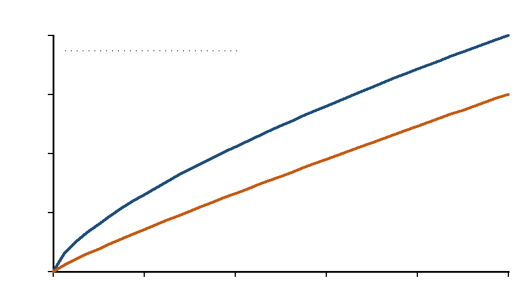

## 1 引言

这是一份**生成器烟雾测试**文档，不是实验报告。它用于检查封面、标题、正文、图片、图注、三线表、公式、列表、引用和页码是否按规范生成。正文中的数值均为*合成示例*，不得写入真实报告。

本段用于检查首行缩进、1.5 倍行距、两端对齐和中英文混排：示例 A 的 Tm 为 123.4 ℃，示例 B 的 Tg 约为 81 ℃。

> 这是一条边界句示例：该结果只能说明示例生成器可工作，不能说明任何真实样品的热性能。

## 2 数据与结果

### 2.1 示例图



由图 1 可见，两条合成曲线在 100–200 之间单调上升；示例 A 的斜率大于示例 B。该图仅用于检查嵌图、缩放和图注位置。

### 2.2 示例表

表 1　合成示例数据（非实验数据）

| 样品 | Tm / ℃ | ΔH / (J·g⁻¹) | 是否纳入 |
|---|---:|---:|---|
| 示例 A | 123.4 | 60.5 | 是 |
| 示例 B | 120.1 | 70.3 | 是 |
| 示例 C | — | — | 否（超范围） |

表注：示例 C 不参与拟合，仅用于检查排除行。

### 2.3 公式与列表

$$ A = kc + b $$

- 列表项一：检查悬挂缩进；
- 列表项二：检查中文标点。

1. 编号项一；
2. 编号项二。

```text
code block: 检查等宽字体与灰底
```

<!-- pagebreak -->

## 3 结论

本示例只验证 DOCX 生成链路：封面、标题、正文、图、表、公式、页码均可生成。真实报告必须使用本次 DATA 文件，并按 `REVISION_WORKFLOW.md` 做四遍改稿。

## 参考文献

[1] 高分子物理实验课程组. 高分子物理实验讲义（2026 版）[Z]. 广州: 华南理工大学前沿软物质学院, 2026.
